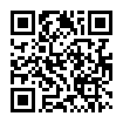
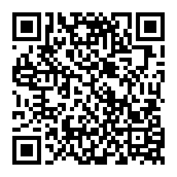

Bitcoin signers and seed backups built from cheap, old or unexpected hardware.
Everything here is air-gapped, open source and early. Read the code before you
trust it, and don't put funds on the alphas.

| Project | What it is | Latest |
| --- | --- | --- |
| [dtmf-signer](https://github.com/ndssigner/dtmf-signer) | A signer you build on a breadboard around a Raspberry Pi Pico. It hears PSBTs as phone tones and never shows the seed. Its newest build, the Phone Exchange (PEX), has no screen and no buttons: an old tone telephone is its whole interface | v0.3.0-alpha |
| [nds-signer](https://github.com/ndssigner/nds-signer) | SeedSigner's code on a Nintendo DSi, with QR through the camera or phone tones | v0.2.2-alpha |
| [ur-tones](https://github.com/ndssigner/ur-tones) | The tone format both signers speak: UR parts as DTMF, over a cable or through the air, plus a [web tool](https://ndssigner.github.io/ur-tones/) for Sparrow | v0.5.1 |
| [seedcraft](https://github.com/ndssigner/seedcraft) | Seed backups as beads, bricks or cards, readable by software ([web tool](https://ndssigner.github.io/seedcraft/)) or by hand with a pencil | v1.0.2 |

## Why

I don't think self-custody should mean buying a device that screams "Bitcoin"
and gets shipped to your address. So everything here either borrows hardware
that already lives another life, or uses generic parts you put together
yourself.

A Nintendo DSi in a drawer looks like an old toy, not a wallet. A seed kept
as beads looks like a necklace. A desk phone wired to a small box looks like
an old telephone, because it is one. That kind of plausible deniability is also
cheap: a used DSi costs around $50, and a Pico build about $13 in parts.

Building it yourself, or reusing something nobody would bother to tamper
with, is the best answer I know to supply-chain attacks like the implants
found in Ledger and Trezor devices in 2026. DTMF-Signer goes a step further: the seed never shows on
its screen, and it has no random number generator that could fail.

And I like old machines. Data that travels as sound needs no camera and no
network, so a cassette, an MP3 player or, one day, an HP 48 or a Commodore 64
can be part of the chain.

The PEX had an effect I didn't plan: a signer you use through a telephone
needs no screen, so it opens a way to Bitcoin tools for blind people. It
reads every output aloud before you sign, and you confirm by ear and by
the keypad. No blind user has tried it yet; if you are one, or work with
blind people, I'd like to hear what it gets wrong.

These are weekend projects: alpha, unaudited, and open to anyone who wants
to help or take them further.

If you speak a language other than English or Spanish, the PEX needs a
[voice pack](https://github.com/ndssigner/dtmf-signer/blob/main/docs/voice-packs.md)
in it.

The most useful thing you can send is a review: open an issue, or find me on
[Stacker News](https://stacker.news/ndssigner) and Nostr
(`npub1n2yw95vqalqzckdnks4sedzyyjg75lasmfntt8xlecdnnwza7kkqn84hjz`).

## Donate

All of this is free and has no funding. Donations help keep it going:

<table>
<tr><td align="center"> <b>Bitcoin</b> <code>bc1qx5snc0wlc8cg9gwxhyx27y6pkru8rnngyq7uja</code></td>
<td align="center"> <b>Lightning</b> <code>ndssigner@coinos.io</code></td></tr>
</table>

Lightning wallets without Lightning addresses can use the LNURL: <code>LNURL1DP68GURN8GHJ7CM0D9HX7UEWD9HJ7TNHV4KXCTTTDEHHWM30D3H82UNVWQHKUERNWD5KWMN9WGQ8XE42</code>

NDS-Signer is built on [SeedSigner](https://github.com/SeedSigner/seedsigner):
please support it too, at [seedsigner.com](https://seedsigner.com).
